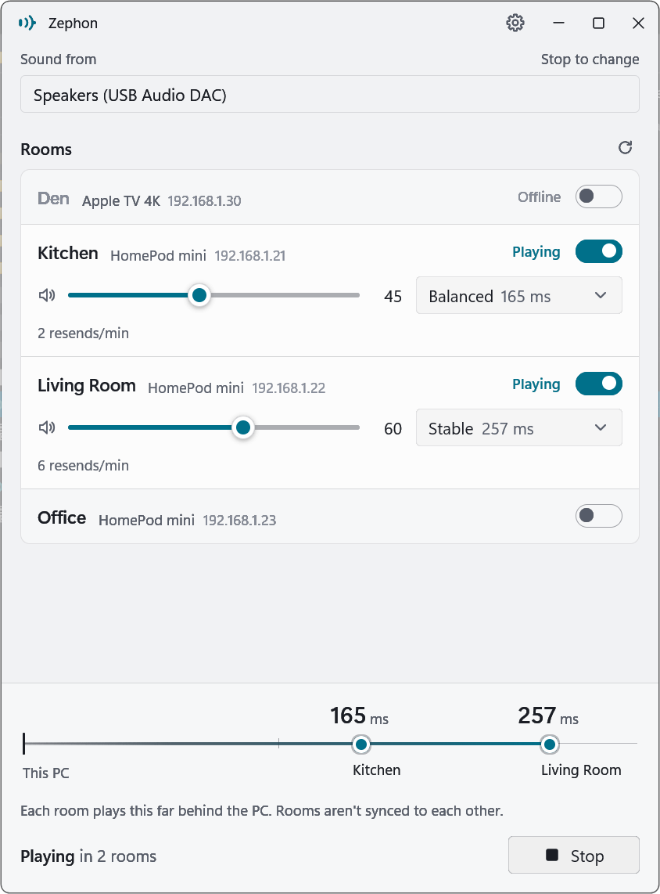
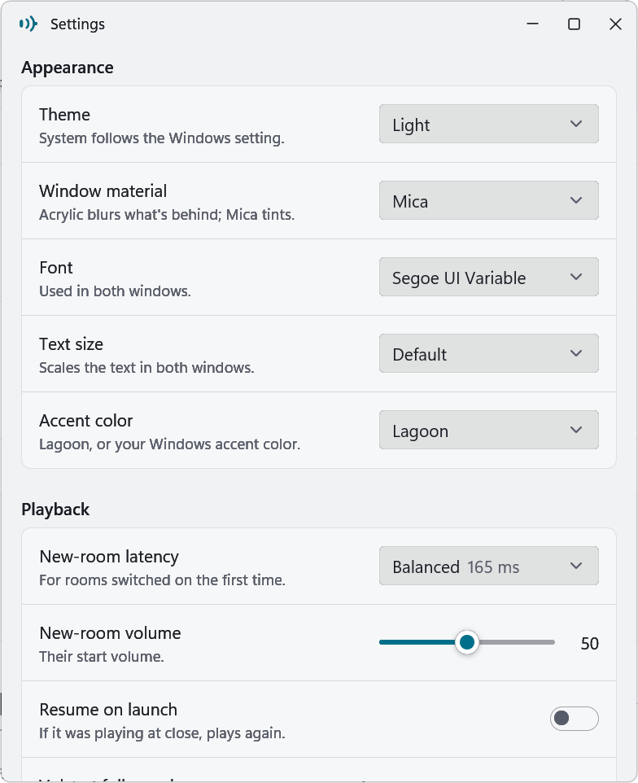

# Zephon

Play your Windows PC's sound on AirPlay 2 speakers such as the HomePod mini.

Zephon captures everything the PC plays through a chosen playback device and streams it to one
or more AirPlay 2 receivers on your network. It is a small native Windows 11 app with a GUI and
a command line.

<picture>
  <source media="(prefers-color-scheme: dark)" srcset="docs/screenshots/main-dark.png">
  
</picture>


> **Alpha.** Zephon works on the author's setup, but it has had little testing on other
> networks and devices. See [Limitations](#limitations).

## Why

HomePod Software 27.0 stopped accepting AirPlay 1 (RAOP) streams, so older Windows senders
such as TuneBlade can still find a HomePod but can no longer play to it. Zephon speaks AirPlay 2
(realtime audio with transient pairing, NTP timing and PCM), which HomePods still accept.

## Features

- Streams system audio from any playback device (WASAPI loopback), not just the default one.
- Several rooms at once from one shared capture. A room that fails does not stop the others, and
  a room that loses its connection while playing reconnects by itself.
- Per-room volume, applied live, and optionally following volume changes made on the phone or
  HomePod.
- Per-room latency profile: **Low** (about 125 ms behind the PC), **Balanced** (165 ms, the
  default) or **Stable** (257 ms, rides out Wi-Fi drops). A lag line shows where each room sits.
- Network loss shown per room (resends and lost packets per minute).
- Windows 11 look: Mica or Acrylic glass, light and dark theme, Windows accent color, font and
  text size settings.
- Optional start with Windows and resume playing on launch.
- A command line for scripting: list devices and receivers, stream for a fixed time.

## Requirements

- Windows 11 (Windows 10 may work, without the glass effects).
- AirPlay 2 receivers on the same LAN. Tested with HomePod mini. Other AirPlay 2 speakers and
  TVs are found and may work.
- An inbound Windows Firewall rule for `zephon.exe` (the app offers to add it, see below).

## Install

1. Download `zephon-<version>-windows-x64.zip` from
   [Releases](https://github.com/Martyrer/zephon/releases) and unzip it into a folder you will
   keep, for example `%LOCALAPPDATA%\Programs\Zephon`.
2. Run `zephon.exe`.

The exe is not code-signed yet, so Windows SmartScreen may show "Windows protected your PC".
Choose **More info**, then **Run anyway**. You can also [build it yourself](#build-from-source).

### First run: the firewall rule

Receivers send timing requests back to the PC from a random port. Windows drops them unless an
inbound rule allows this exe, and the receiver then refuses the stream. When the rule is
missing, Zephon shows a banner with **Install firewall rule**. It shows one UAC prompt and adds
an inbound allow rule for this exe's exact path (all protocols, all network profiles). It also
removes any inbound block rules for this exact exe, since a block rule wins over an allow rule.

The rule is tied to the path. If you move the exe, add the rule again.

## Use

1. **Sound from**: pick the playback device whose sound you want to send.
2. **Rooms**: switch on the rooms that should play. Set each room's volume and latency profile.
3. Press **Play**.

Rooms are not clock-synced to each other yet, so two rooms play slightly offset (see the lag
line). The gear in the title bar opens the settings window.

### Command line

```
zephon devices                 # playback devices; * = the one used by default
zephon receivers               # 3 s browse for AirPlay 2 receivers
zephon firewall --check        # read-only
zephon firewall --install      # one UAC prompt
zephon stream --receiver Kitchen --volume 30 --profile balanced --duration 15
zephon stream --receiver Kitchen --receiver "Living Room"   # until Ctrl+C
```

`zephon.exe` is a GUI program, so a terminal does not wait for it: the prompt returns at once
and the output follows it. In PowerShell, use `zephon stream ... | Out-Host` to wait. In cmd,
use `start /wait zephon stream ...`. Exit code 1 means a session failed.

### Files

Settings, the log and the receiver cache live in `%APPDATA%\Zephon\`. Delete the folder to reset
the app.

## Limitations

- **Rooms are not synced.** Each room has its own session and clock. Expect an audible offset
  between rooms, even on the same profile.
- **Reconnects only 3 times.** A room that loses its connection while playing is started again
  after 2, 4 and 8 s. If that fails (for example after a long sleep or a receiver reboot), press
  Play again. The `stream` command does not reconnect.
- **DRM and exclusive-mode audio** cannot be captured by WASAPI loopback.
- **Rooms are identified by name.** Two receivers with the same name show as one room. Give each
  receiver a unique name in the Home app.
- **Receiver support.** Only HomePod mini has been tested. AirPlay 1-only receivers are not
  supported.
- **Untested:** long sessions, sleep and resume, many rooms at once.

## Build from source

Needs Windows, Rust stable with the MSVC toolchain (edition 2024, rustc 1.95 or newer) and the
Visual Studio C++ build tools.

```
cargo build --release
```

The exe is `target\release\zephon.exe`. A cold build compiles about 800 crates and takes several
minutes. `Cargo.lock` is committed: it pins the transitive dependencies of the git dependencies
below, so build with `--locked`.

See [docs/ARCHITECTURE.md](docs/ARCHITECTURE.md) for how the code is laid out, and
[CONTRIBUTING.md](CONTRIBUTING.md) before opening a pull request.

## Credits

- The AirPlay 2 protocol, capture pipeline, discovery and firewall code come from the
  [Nyx-Refrain](https://github.com/pStrikeZ/Nyx-Refrain) library crates (MIT), pinned to release
  0.9.3. Zephon is the app around them.
- The GUI is built with [gpui-kit](https://gpui-kit.com) on Zed's [GPUI](https://www.gpui.rs/).

## License

Licensed under either of

- Apache License, Version 2.0 ([LICENSE-APACHE](LICENSE-APACHE))
- MIT license ([LICENSE-MIT](LICENSE-MIT))

at your option. Release builds include the licenses of all bundled dependencies in
`THIRD-PARTY-LICENSES.html`.

Unless you explicitly state otherwise, any contribution intentionally submitted for inclusion in
the work by you, as defined in the Apache-2.0 license, shall be dual licensed as above, without
any additional terms or conditions.

## Trademarks

AirPlay, HomePod and Apple TV are trademarks of Apple Inc., registered in the U.S. and other
countries. Zephon is an independent project. It is not affiliated with, endorsed by or sponsored
by Apple.
